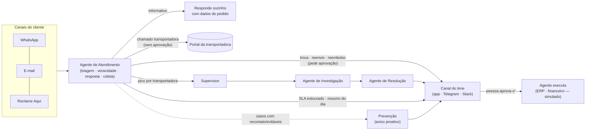

# O colega digital do Atendimento — visão 360°

**Para quem:** o time de Atendimento ao Cliente de um e-commerce (case Gocase), que recebe milhares de contatos por
WhatsApp, e-mail e Reclame Aqui e hoje trata a maior parte à mão, pulando entre sistema de pedidos, portal da
transportadora, ERP e financeiro.

**O que ele é:** um colega de trabalho, não um chatbot. Ele acompanha a caixa, faz sozinho o que está ao alcance dele
(responde com dados do pedido, coleta evidência, abre chamado na transportadora), **levanta a mão** quando não deve
decidir (pede aprovação no canal do time) e **chama outros agentes** quando o problema é maior que um caso.

## Frentes da área (tudo que o colega deveria assumir)

| Frente | O que o agente faz | Onde a pessoa decide | Estado no GoOps |
|---|---|---|---|
| **Atendimento (prova de conceito)** | Caixa unificada estilo WhatsApp, triagem (regras + IA Jev), visão 360, veracidade, respostas, coleta de foto/nº do pedido, encerramento por inatividade | Reclamações com reparação, Reclame Aqui, urgência alta, recontato, intenção incerta | ✅ funcionando ponta a ponta (dados sintéticos) |
| **Logística** | Abre chamado na transportadora sem aprovação; detecta pico de reclamações por transportadora e aciona Monitor/Investigação/Resolução | Realocar volume entre transportadoras | ✅ (execução simulada) |
| **Pós-venda (troca, reenvio, reembolso, cancelamento)** | Propõe a ação certa com evidências e executa após aprovação | Toda ação em pedidos, pagamentos, estoque ou clientes | ✅ (execução simulada) |
| **Prevenção** | Mede recontato e contatos evitáveis, mostra causas, propõe aviso proativo de atraso | Disparo do aviso para clientes | ✅ |
| **Estoque (Desafio 2)** | Cruza estoque × pedidos (FIFO) e propõe contato com clientes de pedidos travados | Contato com clientes | ✅ (setor existente) |
| **Reputação (Desafio 3)** | Painel do Reclame Aqui; respostas públicas sempre revisadas | Resposta pública | 🟡 painel; integração RA HugMe é próxima etapa |
| **Gestão** | Resumo diário, SLA, fila, horas poupadas, acurácia | Metas e premissas (Configurações › Atendimento) | ✅ |

## Como as frentes se conectam

## Onde as pessoas continuam no controle

* **Ações em áreas críticas** (pedidos, pagamentos, estoque, clientes) sempre exigem aprovação humana — regra de
  política, não configurável. O agente propõe; quem tem o papel certo aprova no canal do time ou no GoOps.
* **Reclamações que não se sustentam** nunca são negadas pelo agente: vão para uma pessoa com as evidências.
* **Canal público** (Reclame Aqui) e **casos urgentes** sempre passam por uma pessoa.
* **Matriz configurável** (Configurações › Atendimento): o time decide o que o agente resolve sozinho.
* **Tudo auditado:** cada decisão do agente traz os motivos; cada aprovação, quem aprovou e quando.

## Prova de conceito do dia

A frente **Atendimento** está funcionando de ponta a ponta. As integrações externas (WhatsApp Cloud API, e-mail, RA
HugMe, ERP, portal das transportadoras) estão representadas por conectores configuráveis e simuladores — a troca por
integrações reais substitui só essas peças. O canal do time com **Telegram é real** (bot com aprovação por botão).
